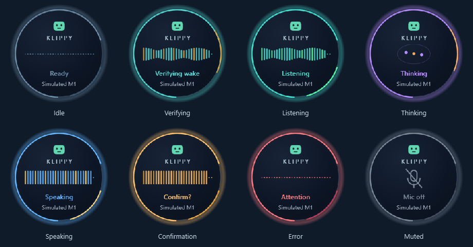

# 0.6 preview — floating voice waveform orb

Qualified engineering-preview application source: `0fbab095214e109240d069746e00f9fea3d429e0`.
All 510 previous regressions and the 0.5.1 safety foundation are preserved.
No physical printer actions, owner recordings or owner-installation changes.

## Behavior

The circular translucent PySide6 orb replaces the rectangular companion. It uses the
existing Klippy mark, glow ring, state label and active-printer name. Settings → Voice Orb
controls enablement, diameter (128–384 logical pixels; default 192), clock/custom position,
three-second default hide delay, printer/status labels, intensity, pinning and animations.
192 pixels means two nominal inches at 96 logical DPI; physical display sizes vary.
Dragging stays within the safe work area; the menu resets above the taskbar clock.
Private backups include validated orb preferences; recovery still revokes printer approval,
heater limits and microphone enablement. Orb settings cannot change those permissions.

Wake candidates immediately show **Verifying wake**, distinct from verified **Listening**.
Listening requires both microphone permission and an opened existing capture stream.
**Thinking** covers transcription, interpretation and TTS preparation; **Speaking** requires
real rendered PCM. **Confirm?** follows the exact SafetyEngine pending action until it
completes, cancels or expires. Errors show brief red **Attention**, manual muted summons
show a slashed microphone, and ordinary idle stays hidden. Existing conversation expiry
drives the fade. Pinning keeps the orb open. Animations off/Windows reduced motion use
static presentation. No independent conversation or authorization clock is added.

Only bounded numeric RMS/peak envelopes come from existing echo-cleaned capture and render
callbacks. A nonblocking producer try-lock drops telemetry when contended. No second
microphone, audio-device thread, network client, PCM recording or transcript store is
created. The visible Qt timer runs at 33 ms, stops when hidden, and uses 100 ms for static
state refresh. Geometry checks run once a second. Render activity has a 150 ms smoothing
tail; numeric peaks expire after 200 ms. Generation-tagged events reject old UI updates;
rejected ASR finishes processing, and old synthesis failures cannot interrupt newer work.

## Geometry and Windows behavior

The tray-icon monitor is preferred, with primary fallback. Read-only native monitor and
taskbar-window observations supplement Qt work areas and detect per-monitor auto-hide.
Native origins also match Qt friendly names when GDI identifiers differ. Conversion is
relative to each monitor's origin; the 10 physical pixel gap rounds within 8–12 pixels at
100/125/150/200%. Auto-hide reserves its full dock strip. Shell-observation failure uses
Qt work areas, reserving a conservative bottom strip if no taskbar exclusion is available.
Custom positions clamp and recover to an available monitor after disconnect.

Topmost frameless tool flags provide no taskbar entry, transparent corners, no keyboard
focus and nonactivating display. Only explicit double-click/Open Klippy opens the panel.
Geometry signals and the bounded refresh respond to display/work-area/DPI changes.
Implementation references: [Qt high DPI](https://doc.qt.io/qt-6/highdpi.html),
[tray geometry](https://doc.qt.io/qt-6/qsystemtrayicon.html),
[Qt window attributes](https://doc.qt.io/qtforpython-6/PySide6/QtCore/Qt.html),
[Windows taskbar geometry](https://learn.microsoft.com/en-us/windows/win32/shell/abm-gettaskbarpos),
[per-monitor auto-hide](https://learn.microsoft.com/en-us/windows/win32/shell/abm-getautohidebarex),
[animation preference](https://learn.microsoft.com/en-us/windows/win32/api/winuser/nf-winuser-systemparametersinfow).

## Development verification

58 new orb regressions cover states, real synthetic capture/render levels, wake candidate
verification, interruption/cancellation, rejected ASR, late synthesis failures, pending
confirmation, microphone readiness, timeouts, malformed preferences/atomic restore,
active-printer/settings controls, window flags and cleanup. Geometry tests cover four DPI
scales, four taskbar edges, auto-hide, tray monitor selection, dragging and disconnects.
The complete 568-case suite and Ruff passed locally and on Windows before packaging.

`--orb-self-test --smoke-report PATH` renders the actual Qt widget using synthetic PCM,
asserts eight states, nonactivation, transparent corners, three sizes, rendered-level
linkage, cleanup and hidden/disabled paint suppression. It writes widget-only captures
and short process CPU/memory samples. Frozen build and installed offline QA require it
alongside all unchanged native model/query/command/voice gates.

[Native development evidence](benchmarks/preview6-orb-native.json): Windows Qt at 125%
rendered **30.43 paints/second**. Active CPU was **21.94% of one core**, versus **14.13%**
with the same 100 Hz synthetic audio producer and orb disabled: about **7.81 percentage
points** incremental CPU in these short, noisy samples. Hidden idle used **0.78%** of one
core and **zero animation paints**. Widget creation increased working set by about
**0.99 MiB** before screenshot buffers; the active interval had no working-set growth.
These process samples are not long-duration or actual 16 GB performance acceptance.

Native observations found bottom taskbars on all four current monitors at 100/125%
scaling. The actual widget remained nonactive in all captures. This verifies current
geometry/rendering, not every interactive desktop scenario.

## Qualification and remaining gates

All jobs in [Windows run 43593883215 attempt 1](https://github.com/khisanthax/Klippy-Assistant/actions/runs/43593883215)
passed at that exact source: 568 tests, no failures/skips, Ruff, frozen startup, all 28 orb
checks in each frozen/installed process, native model/query/command probes, actual 0.5.1
upgrade/reinstall preserving SQLite/name/alias/style/orb fixtures, offline installed runtime,
uninstall preservation and process-tree memory budget. All three Windows firewall profiles
were enabled and external app/language-runtime egress blocked. Both packaged Qt probes
observed Windows reduced motion enabled and correctly used static indicators (one active
state paint, zero hidden/disabled paints); they are not additional 30-FPS animation results.
Installed static CPU was 5.23% of one core versus 4.70% for the same audio producer with orb
disabled; widget creation added about 0.57 MiB working set. Short-sample caveats still apply.

All 21 command cases and seven query cases passed in each frozen/installed/budgeted native
process, with zero printer writes. Both single-attempt Hey wake cases, acknowledgement and
follow-up gates passed. Original broader voice flags were **False / False / True**: frozen
and installed continuous bare-Klippy speech transcribed as “Clibby” and was safely rejected;
the budgeted process transcribed “Clippy” and passed. Original results remain separate and
no prefix or acoustic gate was loosened. Process-tree peak commit was **1.82 GiB** under a
16 GiB budget on an **8 GiB runner**; this is not actual 16 GB hardware qualification.

Installer: `Klippy-Setup-0.6.0-preview.1.exe`, **1,489,813,453 bytes**. SHA-256 matches CI,
the sidecar and installed-QA evidence:
`02f2ea49ea9df3f371d2ddd7380dbc6f05f06c869988c41e9b58d2297f9b0e9b`.
See [aggregate evidence](benchmarks/preview6-release-qualification.json) and retained raw
reports. Earlier candidates 2983975/run 43593542057 and 9a03ca1/run 43593800687 were cancelled
before publication for loop-identity protection and the inherited installer notice label.
The same AppId/settings path upgrades the existing preview. Publication must verify all
uploaded assets and label this unsigned engineering prerelease, never stable.
Issue [#12](https://github.com/khisanthax/Klippy-Assistant/issues/12) tracks acceptance.

Open: real interactive Windows 10/11 100/125/150/200% scaling, auto-hide reveal/retract,
vertical taskbars, multi-monitor tray placement/hot-plug/resolution changes, Explorer
restart, full-screen/focus behavior, reduced motion and sleep/resume. Also open: human
microphone/room wake/interruption accuracy, supervised printer/fleet/MMU safety, clean
desktop VM and actual 16 GB hardware. Original continuous bare-Klippy/ASR failures remain
visible. Synthetic results do not close hardware/acoustic gates.
